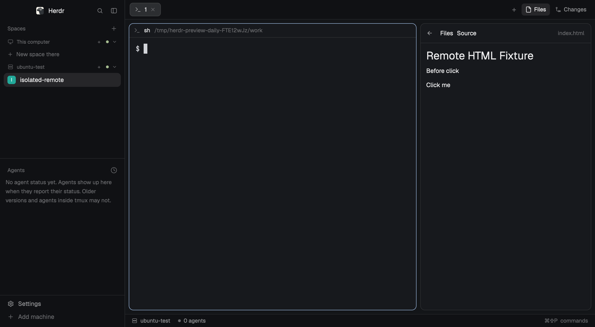

# Herdr Files Preview

這是官方 Herdr App 的 **公測原型**，可在 Files 查看 Markdown、HTML、圖片及 PDF，並透過右鍵選擇 Preview、Chrome 或 Save Copy。

> 目前尚未通過日常使用與安全驗收。建議先在測試 Space 使用非敏感文件。遠端 Chrome 自動更新、動態資源、ES modules、Windows 支援，以及 GUI 另存等項目仍未完成驗證。



上圖是基線版在隔離遠端 Space 的 TextView 測試，不代表 Chrome 已通過互動或完整網站驗收。

## 使用前確認

- 目前的客戶端實作為 **macOS Apple Silicon**，使用官方 Herdr App；Windows 尚不支援。
- 本機需要 Git、Python 3；要用 Chrome 開啟則需要 Google Chrome。PDF 預覽使用 macOS 內建的 PDFKit。
- 遠端預覽需要 Herdr 已連線到遠端 Machine，且遠端有 Python 3。Mod 使用現有 Core 連線執行遠端讀取，不需要另建遠端 HTTP server。
- Mod 會以使用者權限讀取檔案、執行本機程式，並在選定的遠端機器執行 Python。遠端檔案與產生的預覽圖會暫存在本機 Herdr app home。請先閱讀 [Mod 程式碼](mods/files-preview/) 與[限制和測試紀錄](docs/work/README.md)。

## 安裝

安裝器會複製指定 layout，建立新的 `files-preview` 個人 layout 與同名 Mod。它不會修改原 layout；若已有同名 layout 或 Mod，會停止並拒絕覆寫。

1. 啟動 Herdr，開啟 Terminal，取得本 repo：

   ```sh
   git clone https://github.com/swchen44/herdr-app-html-preview.git
   cd herdr-app-html-preview
   ```

2. 設定本次 Herdr 的 app home，並找到 App 指令：

   ```sh
   export HERDR_APP_HOME="${HERDR_APP_HOME:-${XDG_CONFIG_HOME:-$HOME/.config}/herdr-app}"

   if command -v herdr-app >/dev/null 2>&1; then
     HERDR_APP_BIN="$(command -v herdr-app)"
   elif [ -x "$HOME/Applications/Herdr.app/Contents/MacOS/Herdr" ]; then
     HERDR_APP_BIN="$HOME/Applications/Herdr.app/Contents/MacOS/Herdr"
   elif [ -x "/Applications/Herdr.app/Contents/MacOS/Herdr" ]; then
     HERDR_APP_BIN="/Applications/Herdr.app/Contents/MacOS/Herdr"
   else
     echo "找不到 Herdr App，請先安裝或確認安裝路徑"
     HERDR_APP_BIN=""
   fi

   if [ -n "$HERDR_APP_BIN" ]; then "$HERDR_APP_BIN" status; fi
   ```

   確認 `status` 回傳的是你要操作的 Herdr 視窗，並記下目前的 `layout` 名稱，供反安裝時切回。若 App 啟動時用了自訂 `HERDR_APP_HOME`，請在執行上述指令前先將它設為**相同路徑**。若找不到視窗，先確認 App 已開啟且路徑正確。

3. 建立 Mod 與新 layout，檢查後切換：

   ```sh
   python3 scripts/install.py --app-home "$HERDR_APP_HOME"
   "$HERDR_APP_BIN" check "$HERDR_APP_HOME/mods/files-preview"
   "$HERDR_APP_BIN" do layout.switch '{"name":"files-preview"}'
   ```

   安裝器預設複製 `main` layout。若要複製其他 layout，執行安裝時加上 `--base-layout 名稱`；該 layout 必須包含官方 `files` Mod。`check` 檢查初始載入，不代表所有 GUI 與遠端功能已驗收。

## 使用

1. 選擇本機或已連線遠端 Machine 的 Space，打開 **Files**。
2. 對檔案按右鍵，選擇：
   - **Preview**：在 Files 使用原生 TextView 或圖片／PDF 預覽。
   - **Chrome**：用本機 Chrome 開啟。遠端 HTML 會先收集可辨識的靜態相對資源到本機。
   - **Save Copy**：選擇本機目的資料夾，以原檔名建立副本；不會覆寫現有檔案。目前不能在對話框更名。
3. Markdown／HTML 預覽可用 **Preview／Source** 切換。原生 TextView 不執行 HTML JavaScript，也不支援完整 CSS。

遠端 Chrome 使用快照：遠端內容變更後，必須回 Herdr 再次選 **Chrome**，產生新的快照；重新整理舊分頁不會同步遠端變更。動態 URL、ES modules、root-relative URL、`<base>` 及自動更新尚不支援，Chrome 實際渲染與互動也尚未完成驗收。

## 反安裝

1. 在前述 Terminal 中，先切回安裝前記下的 layout。若原本使用 `main`：

   ```sh
   "$HERDR_APP_BIN" do layout.switch '{"name":"main"}'
   "$HERDR_APP_BIN" status
   ```

   若原本是其他 layout，將 `main` 換成該名稱；確認 `status` 已顯示原 layout。若你另外修改過其他 layout 使用 `files-preview` Mod，也要先移除那些引用。

2. 在 Finder 開啟本次 App home：

   ```sh
   open "$HERDR_APP_HOME"
   ```

3. 確認路徑及內容後，將下列**本 Mod 專用項目**移到垃圾桶：
   - `mods/files-preview/`
   - `layouts/files-preview.json`
   - `layouts/.state/files-preview.json`，若存在。`.state` 是隱藏資料夾，可在 Finder 按 `Cmd+Shift+.` 顯示。
   - `data/files-preview/`，若要一併移除本機預覽快取。這會讓仍開啟的快照失效。

反安裝不需要刪除 Herdr App、Core、原 layout 或 Space。移到垃圾桶後仍可還原；若快取曾包含敏感資料，請自行確認垃圾桶與備份的保留方式。

## 限制與驗證

- 遠端單檔上限 5 MiB，逐層拒絕 symlink，分段傳輸並驗證 SHA-256。遠端 HTML 快照最多收集 64 個靜態資源、總計 20 MiB；傳輸期間資源變更會中止。
- PDF 上限 30 頁。超過 7 天的本 Mod 產生快取，只在下次 Mod 操作時嘗試清理，並非定時刪除。磁碟配額、斷線重連、跨 Space 隔離及安全競態尚未完成驗收。
- 目前實測環境與截圖、實際遠端 Core 測試和未測項目見 [docs/work](docs/work/README.md)。

Herdr 官方的分享慣例是 `mods/<name>/`、`RECIPE.md`、`preview.png`，GitHub repo 加 `herdr-mod` topic；安裝時應先閱讀所有檔案並避免覆寫。參考 [Herdr Mod 指南](https://github.com/herdrdev/herdr-app/blob/7fe7ac34fef8a3ee76cb5d2f17bc8d6331e50bd8/defaults/AGENTS.md#layouts-and-mods-other-people-made)。本 repo 尚未標記為官方審核或正式發布的 Mod。
